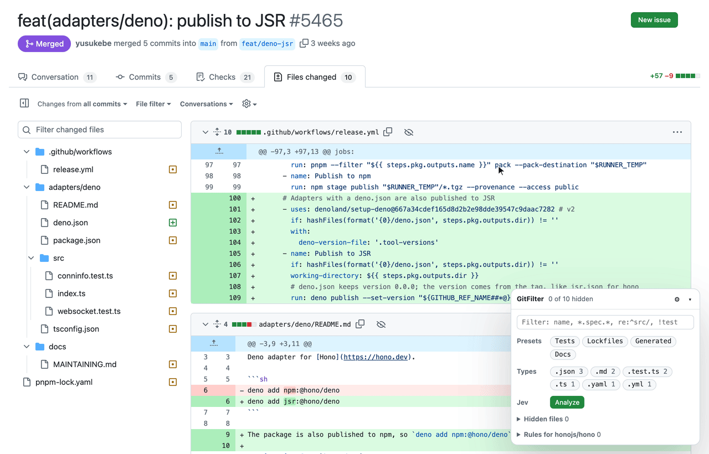

# GitFilter

A Chrome extension that adds file filtering to GitHub pull request “Files changed” pages, with optional
[Jev](https://docs.typesafe.ai/introduction) suggestions for low-interest files.



## Features

- **Rules** (gitignore-style, last matching line wins), per repository or global:
  - `*.spec.*` hides a file name anywhere (`src/a/user.spec.ts`)
  - `src/gen/**` or `/README.md` match from the repository root
  - `docs/` matches a directory and everything below it
  - `!critical.spec.ts` shows a file again
  - `re:^api/.*\.json$` is a regular expression on the full path
- **Presets**: Tests, Lockfiles, Generated, Docs (global on/off).
- **File type chips** built from the PR’s files, with compound kinds such as `.spec.ts`, `.test.js`, `.d.ts`.
- **Search box**: substring, glob or `re:`; a leading `!` keeps only files that do *not* match.
- **Hide button** (crossed-out eye) in every file header, next to the file name.
- **Hidden files** list in the panel with the reason each file is hidden, **Show** (also scrolls to the file),
  and **Always hide** for files hidden by hand or by a Jev suggestion.
- Hidden files disappear from both the diff list and GitHub’s file tree (empty directories too).
- **Jev indicators** (off by default): click **Analyze** to classify each changed file. Each file header
  then shows Jev’s file kind (`lockfile`, `tests`, …), a review-attention meter with the score
  (`Low 0.8`), and a **Low interest** label on files Jev suggests hiding. Hover a label for details.
  Nothing is hidden until you click the header’s hide button, **Hide N** in the panel, or **Always hide**
  (which adds an exact-path rule for the repository). The × on a **Low interest** label dismisses it.

## Install

Requires [Bun](https://bun.sh) 1.3 or later and Chrome 120 or later.

```sh
git clone https://github.com/H3xept/git-review-filter.git
cd git-review-filter
bun install
bun run build        # writes dist/
```

1. Open `chrome://extensions` and turn on **Developer mode**.
2. Click **Load unpacked** and choose the `dist/` folder.
3. Open any pull request’s **Files changed** tab. The GitFilter panel appears in the bottom-right corner.

`bun run watch` rebuilds on change; click the reload icon on `chrome://extensions` afterwards.

## Jev setup

1. Click the GitFilter toolbar icon (or ⚙ in the panel) to open the options page.
2. Turn on **Enable Jev suggestions**.
3. Read the data notice and tick **I understand and agree to send this data**. For each analyzed file,
   GitFilter sends the PR title, the file path, change type, line counts and up to 3,000 characters of the
   diff to `api.typesafe.ai`.
4. Paste your TypeSafe API key and click **Test key**. The key stays in `chrome.storage.local` on this
   device; only the extension’s own pages and service worker can read it (GitHub pages cannot).
5. Optional: tick **Also allow private repositories**. Without it, analysis is refused on private repos.

### How suggestions are made

For every file, one Jev request asks three questions over a small state
(`pull_request.title`, `file.path`, change type, line counts, `file.diff_excerpt`):

| Question | Type | Use |
| --- | --- | --- |
| What kind of file is this? (logic, tests, fixtures, docs, config, lockfile, generated, assets, styles) | Choice | role and its probability |
| Is every change mechanical (formatting, renames, version bumps)? | Noul | mechanical probability |
| How much careful review attention does this change need? (None / Low / Medium / High) | Score | attention, 0–3 |

The extension combines the answers in code:

- attention below the threshold (default 0.75) → suggested;
- otherwise, while attention stays below 1.5: a lockfile, generated/vendored code, or an asset (≥ 80 %
  probability), a role you selected in options (≥ 80 %), or a mechanical change (≥ 90 %) → suggested;
- binary files are suggested without an API call.

Changing the threshold or roles re-classifies the existing answers without new requests. Answers are
cached by the file’s full diff chunk, the rubric version and the model alias, so re-analysis after
navigation is free until the file changes. Already hidden files are not sent. A run is capped at 300 files.

## Supported pages

- `/<owner>/<repo>/pull/<n>/files` (classic view) — verified live.
- `/<owner>/<repo>/pull/<n>/changes` (the React view GitHub shows signed-in users by default) — the adapter
  uses selectors taken from [refined-github](https://github.com/refined-github/refined-github)’s new-view
  features; see *Limitations*.
- Soft navigation between PR tabs, back and forward.

## Development

```sh
bun test             # glob, rules, diff parser, Jev classification
bun run typecheck
```

Layout:

```
src/core/       pure logic: glob.ts, rules.ts, diff.ts, jev.ts, settings.ts
src/content/    github.ts (DOM adapter), insights.ts (file-header indicators), panel.ts (Shadow-DOM UI),
                dom.ts (element helpers), main.ts (page session + lifecycle)
src/background.ts  service worker: PR .diff fetch, Jev calls (4 in flight, retry/backoff), answer cache
src/options/    options page
```

Hiding works by setting `data-gitfilter-hidden` on each file container and tree row from a
`MutationObserver`, so files that GitHub renders later are hidden before they paint. The same pass inserts
the hide button and Jev indicators after each file name.

## Limitations

- **Signed-in React view not verified live.** Its DOM was taken from refined-github’s source, because an
  anonymous browser only receives the classic view. If the panel shows files but does not hide them on
  `/changes`, or the header indicators are missing, the selectors in `src/content/github.ts` need updating.
- GitHub’s experimental *virtualized* mode for very large PRs keeps most files out of the DOM; counts then
  come from the PR `.diff`, and hiding applies as files mount.
- Jev results and accepted suggestions last for the page session. Use **Always hide** to keep one.
- The PR `.diff` comes from `github.com/<repo>/pull/<n>.diff`. Very large PRs can fail to load; the
  panel then lists only the files GitHub has rendered and Jev analysis is unavailable.

## Contributing

Issues and pull requests are welcome at
[github.com/H3xept/git-review-filter](https://github.com/H3xept/git-review-filter). Before you open a pull
request, run `bun test`, `bun run typecheck` and `bun run build`. CI runs the same three commands.

## License

[MIT](LICENSE). GitFilter is not affiliated with or endorsed by GitHub or TypeSafe.
